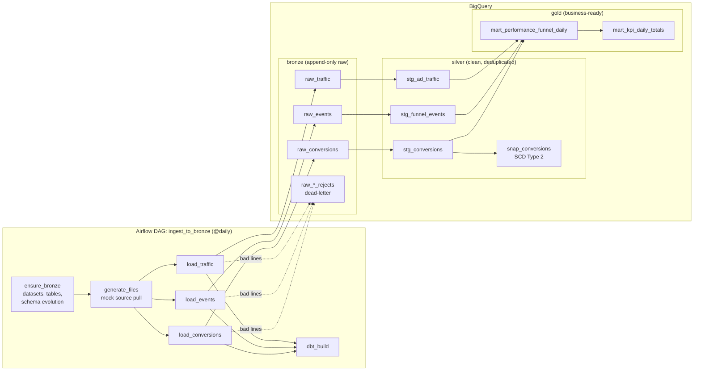
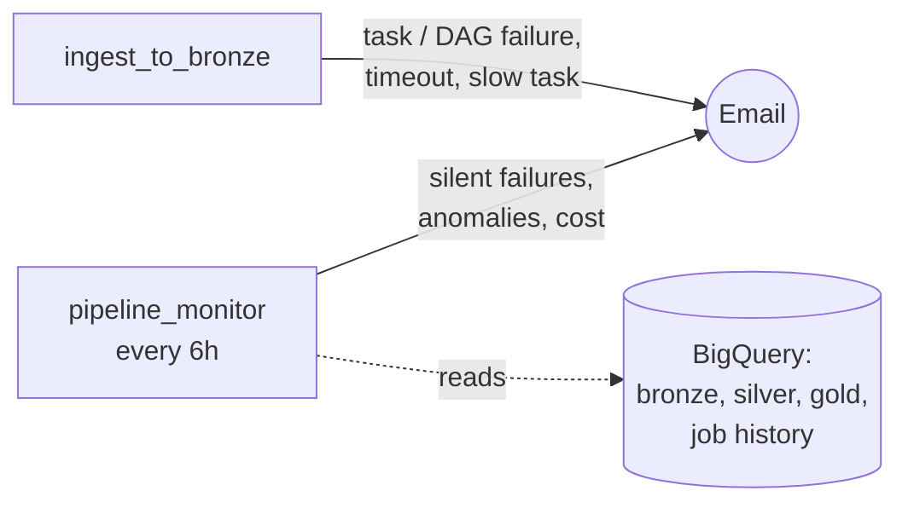

# Performance Marketing Analytics Pipeline

An end-to-end batch data pipeline for a **lead-generation performance-marketing** business. It runs on **Airflow → BigQuery → dbt** with a medallion architecture (bronze / silver / gold).

Paid clicks come in from ad partners, users move through a landing-page funnel, and leads are sold to buyers. The pipeline turns raw, messy event files into trusted daily KPIs (spend, CPL, EPC, margin). Along the way it handles the problems real pipelines face: duplicates, late data, broken pulls, schema drift, and records that change after the fact.

> The data is synthetic, generated on every run by `data/generate_data.py`, so the whole system can be demonstrated live.

---

## Contents
1. [Architecture](#1-architecture)
2. [Tech stack](#2-tech-stack)
3. [Step 1 — Source: the mock data generator](#3-step-1--source-the-mock-data-generator)
4. [Step 2 — Bronze: Airflow ingestion](#4-step-2--bronze-airflow-ingestion)
5. [Step 3 — Silver: dbt staging](#5-step-3--silver-dbt-staging)
6. [Step 4 — Gold: dbt marts](#6-step-4--gold-dbt-marts)
7. [Edge cases and how each one is handled](#7-edge-cases-and-how-each-one-is-handled)
8. [Alerting and monitoring](#8-alerting-and-monitoring)
9. [Testing strategy](#9-testing-strategy)
10. [How to run it](#10-how-to-run-it)
11. [Live demo scripts](#11-live-demo-scripts)
12. [Results from real BigQuery runs](#12-results-from-real-bigquery-runs)
13. [Design decisions and trade-offs](#13-design-decisions-and-trade-offs)
14. [Limitations and next steps](#14-limitations-and-next-steps)

---

## 1. Architecture



| Layer | Purpose | Written by | Load pattern |
|---|---|---|---|
| **Bronze** | Exact, replayable copy of every file received, plus ingestion metadata | Airflow | Append-only (`WRITE_APPEND`) |
| **Silver** | One clean, typed, deduplicated row per business key | dbt | Incremental `MERGE` |
| **Gold** | Business metrics, ready for dashboards and decisions | dbt | Full rebuild (`table`) |

---

## 2. Tech stack

| Tool | Version | Role |
|---|---|---|
| Apache Airflow | 2.10.5 (Python 3.12, Docker) | Orchestration, ingestion |
| Google BigQuery | — | Warehouse (partitioned and clustered tables) |
| dbt-core + dbt-bigquery | 1.9 | Transformations, tests, snapshots |
| Docker Compose | — | Local runtime with versions pinned and asserted at build time |
| pytest | — | Unit tests for the ingestion logic |

Airflow doesn't support the host's Python 3.14, so **everything runs inside the container**. The `Dockerfile` installs Airflow with its official constraints file and puts dbt in its own virtualenv, so their dependencies can't clash. The build **fails fast** if Python isn't 3.12.

---

## 3. Step 1 — Source: the mock data generator

`data/generate_data.py` simulates one pull from three upstream systems:

| File | Grain | Key | Content |
|---|---|---|---|
| `ad_traffic.ndjson` | One paid click | `traffic_id` | partner, campaign, source, cost |
| `funnel_events.ndjson` | One funnel step | `event_id` | `landing_view → form_start → form_submit` |
| `conversions.ndjson` | One sold lead | `conversion_id` | buyer, lead status, revenue, partner payout |

**Realistic problems are built in on purpose:**
- **5% exact duplicates** in every file, simulating a retried API call
- **10% late-arriving conversions**: the buyer reports the lead 12–48h after the form submit

**Switches for demos** (environment variables):
- `FAULTS=malformed_lines,missing_key,schema_drift,empty_file` breaks the output on purpose (see §7)
- `RESTATE_FROM=<previous conversions file>` re-sends about 5% of earlier leads as **buyer returns**, the SCD2 scenario

With neither set, the output is the clean baseline.

---

## 4. Step 2 — Bronze: Airflow ingestion

`dags/ingest_to_bronze.py` (pure helpers in `dags/bronze/loader.py`):

```
ensure_bronze >> generate_files >> [load_traffic, load_events, load_conversions] >> dbt_build
```

| Task | What it does |
|---|---|
| `ensure_bronze` | Creates the `bronze` dataset, the 3 raw tables and 3 rejects tables if missing. **Schema evolution**: adds any new nullable column to existing tables before data arrives. |
| `generate_files` | Runs the generator into `data/landing/<run timestamp>/`, passing through the `faults` DAG param and the previous run's folder (`RESTATE_FROM`). |
| `load_<entity>` ×3 | Validate, quarantine, guard, append. The three run in parallel (see below). |
| `dbt_build` | Builds and tests silver and gold, then runs the unit tests. Runs only if no load failed (`trigger_rule="none_failed"`). |

**Inside each load task:**
1. **Batch ID**: `<entity>_<sha256 of the file>`. The same file always gets the same ID.
2. **Double-load guard**: if that `_batch_id` is already in the bronze table, the task **skips**. Retries and re-triggers can never append a file twice.
3. **Validate every line** (`split_records`). Bad lines are separated, each with a reason.
4. **Broken-pull check**: if there are 0 valid lines, or more than 1% are bad, the task **fails before writing anything**, so a retry starts clean.
5. Write the bad lines to `raw_<entity>_rejects`, the **dead-letter** table.
6. Append the good lines to `raw_<entity>` with `_ingested_at`, `_batch_id` and `_source_file` added.

**Why bronze is append-only:** it's the audit trail. Nothing is ever updated or deleted, so silver and gold can always be rebuilt from scratch, and duplicates are kept on purpose for silver to resolve.

**Table design:**
- Raw tables are **partitioned by `DATE(_ingested_at)`** (load day) and **clustered by `_batch_id`**.
- Incremental reads only touch new load days, and the double-load guard reads very little data.
- `timestamp` stays a STRING in bronze, so a malformed value can never fail the load. It's parsed in silver.

---

## 5. Step 3 — Silver: dbt staging

`dbt/models/staging/`: one model per entity, each **incremental with `MERGE`**:

```sql
with src as (
  select * from {{ source('bronze', 'raw_events') }}
  
  where _ingested_at > {{ incremental_watermark() }}   -- only new load batches
  
)
...
qualify row_number() over (partition by event_id order by _ingested_at desc, _batch_id desc) = 1
```

- **Deduplication**: `ROW_NUMBER()` keeps exactly one row per business key (`traffic_id`, `event_id`, `conversion_id`), the most recently ingested version. `MERGE` on that key means a key that shows up again in a later batch **updates** the existing row instead of duplicating it.
- **Partition pruning** (`macros/incremental_watermark.sql`): the watermark is computed first and written into the SQL as a **constant** timestamp.
  - BigQuery can only skip partitions on a constant. A subquery like `(select max(...) from this)` forces a scan of all of bronze.
  - Dry-run proof: the subquery filter scanned **473 KB**, the constant filter **0 bytes**, for a day with no new data.
- **Typing**: `safe.parse_timestamp` turns bad timestamps into NULL, which a `not_null` test then catches. Bad data never crashes a model.
- **Late-arrival flag** (`stg_conversions`): `conversion_lag_seconds` measures the time from the session's `form_submit` to the conversion. `is_late_arriving` means a lag of more than 60 minutes (var `late_arrival_threshold_minutes`).
- **SCD Type 1 + Type 2** for lead returns (§7):
  - silver keeps the latest status
  - the **`snap_conversions` snapshot** keeps every version, with `dbt_valid_from` and `dbt_valid_to`
- `on_schema_change: append_new_columns`: new source columns flow into silver automatically.

**Data tests** (`schema.yml`):
- `unique` and `not_null` on every key
- `accepted_values` on partner, source, step, variant, lead status and buyer
- `relationships` from events to traffic, and from conversions to events

---

## 6. Step 4 — Gold: dbt marts

### `mart_performance_funnel_daily`
- **Grain:** click date × partner × campaign × traffic source.
- **Attribution:** sessions and conversions are attributed back to the **click** through `traffic_id → session_id`. A late conversion therefore lands on its original click date.
- **No fan-out:** events and conversions are rolled up to one row per session **before** joining, so row counts can't multiply.
- **Metrics:** spend, clicks, sessions, form starts, leads, accepted leads, revenue, partner payout, margin.
- **Rates use defensive division:** `cpl = spend / nullif(leads, 0)` and `epc = revenue / nullif(clicks, 0)`. A zero denominator gives NULL, never an error or a misleading 0.

### `mart_kpi_daily_totals`
- **Grain:** one row per day, partitioned by date. Built for dashboards: filter by date without aggregating thousands of rows.
- **Rates are recalculated from summed totals, never averaged.** Example: partner A spends 100 for 1 lead (CPL 100), and partner B spends 10 for 10 leads (CPL 1). The real CPL is 110 / 11 = **10**. Averaging the two CPLs would give **50.5**, which is wrong. A unit test locks this in.

---

## 7. Edge cases and how each one is handled

| Edge case | What happens | Where | Proven by |
|---|---|---|---|
| **Exact duplicates** (API retry) | Kept in bronze; silver keeps 1 row per key | `stg_*` `ROW_NUMBER` | unit test + `unique` tests |
| **Same key in a later batch** | Later version wins (`MERGE` updates the row) | `stg_*` | unit test |
| **Airflow retry / re-trigger** | Same file → same batch ID → load **skipped** | load task guard | live run (§11) |
| **Partial failure** (1 of 3 loads fails) | `dbt_build` blocked; retry only reloads what's missing | `trigger_rule` + guard | live run |
| **Late-arriving conversion** | Attributed to the click date; flagged `is_late_arriving` | `stg_conversions`, funnel mart | unit test |
| **Lead return** (record changes later) | Silver: latest status (SCD1). Snapshot: full history (SCD2). | `stg_conversions`, `snap_conversions` | unit test + live run |
| **Malformed or wrong-typed line** | Quarantined in `raw_*_rejects` with the reason; the batch still loads | `split_records` | pytest + live run |
| **Missing primary key** | Quarantined | `split_records` | pytest |
| **Schema drift** (unexpected field) | Every line rejected → reject rate too high → load **fails before writing** | `check_batch_acceptable` | pytest + live run |
| **Empty file** (pull "succeeded" with no data) | Load **fails** rather than silently loading 0 rows | `check_batch_acceptable` | pytest |
| **New column added deliberately** | `ensure_bronze` adds it; dbt appends it to silver | schema evolution | live run |
| **Unparseable timestamp** | NULL in silver → `not_null` test fails the build | `safe.parse_timestamp` | data tests |
| **Zero denominators** | NULL rates, no errors | marts (`nullif`) | unit tests |

### Late arrival vs SCD: two different problems
- **Late arrival is about timing.** There's **one** version of the record, and it shows up late. The response is to attribute it to the event date and flag the delay.
- **SCD is about change.** The **same** record gets new values later, for example a buyer returns a lead. The response is to overwrite (Type 1) or keep history (Type 2).

| conversion_id | lead_status | revenue | dbt_valid_from | dbt_valid_to |
|---|---|---|---|---|
| cnv_20c587c9 | accepted | 41.31 | 2026-10-09 19:06 | 2026-10-16 08:58 |
| cnv_20c587c9 | rejected | 0.00 | 2026-10-16 08:58 | *(current)* |

*(real rows from `silver.snap_conversions`)*

Returned leads keep their **original** `timestamp`, and the return time goes in a separate `status_updated_at`. A return is therefore never mistaken for a late arrival.

---

## 8. Alerting and monitoring

A pipeline that fails quietly is worse than one that fails loudly. Alerting works in **two layers**, and every alert is an email (Gmail SMTP).



### Layer 1 — loud failures, from the ingestion DAG (`dags/alerts/notify.py`)
| Alert | Trigger | Severity |
|---|---|---|
| **Task failed** | Any task fails after its retries. Includes the error and a log link. | CRITICAL |
| **DAG run failed** | The run failed. Lists the failed tasks, the tasks that **never ran**, and says when silver and gold are now stale (`dbt_build` didn't run). | CRITICAL |
| **Stuck task** | A task exceeds its hard `execution_timeout` (generate 5 min, load 10 min, dbt 20 min; the whole run 1h). It's killed, so it fails and alerts. | CRITICAL |
| **Slow task** | A task succeeded but took about 3× longer than normal (soft limits in `SOFT_LIMITS_SECONDS`). An early warning. | WARNING |

### Layer 2 — silent failures, from an independent monitor (`dags/pipeline_monitor.py`, `dags/alerts/checks.py`)
The monitor runs every 6 hours, **separately from ingestion**, so it notices when ingestion didn't run, stopped part-way, or finished with bad data.

| Check | Catches | Severity |
|---|---|---|
| **Freshness** | No new bronze data for 26h: the DAG isn't running, or every load fails | CRITICAL |
| **Silver behind bronze** | Bronze has a batch that silver doesn't: `dbt_build` was blocked or failed | CRITICAL |
| **Quarantined lines** | Rows in `raw_*_rejects` in the last 24h, with example errors | WARNING |
| **Volume anomaly** | Latest batch under 50% or over 200% of the last 7 batches' average | WARNING |
| **KPI anomaly** | Yesterday's CPL or EPC is more than 50% off the 7-day average (only checked with 20+ leads, to avoid noise) | WARNING |
| **BigQuery cost** | Month-to-date query cost from `INFORMATION_SCHEMA.JOBS_BY_PROJECT` × $6.25/TiB. It covers **every** query in the project, console ones included. | WARNING ≥ $1.50, CRITICAL ≥ $3.00 |
| **Monitor health** | A check that can't run (for example, a missing permission) is reported, never silently skipped | CRITICAL |

**Design choices:**
- **One email per monitor run**, listing every finding with critical ones first. That avoids a flood of separate emails.
- **Throttling:** a finding already emailed in the last 12h isn't repeated (`should_send`). Failure alerts from Layer 1 are never throttled.
- **Alerting can't break the pipeline.** If SMTP is down or not configured, the alert is logged instead and the task still succeeds.
- **All checks are pure Python functions** over query results, unit-tested with synthetic inputs (stale, behind, spikes, costs of $1.20 / $1.80 / $3.50).
- **The cost estimate is deliberately conservative:** it ignores the 1 TiB/month free tier, so it warns before real money is charged.

### Cost guardrails: prevention, not just alerts
| Guardrail | Effect |
|---|---|
| `maximum_bytes_billed: 1 GB` in `dbt/profiles.yml` | BigQuery **refuses** any single dbt query that would scan more than 1 GB. A runaway query fails instead of billing. |
| `maximum_bytes_billed` on every Airflow query | Same cap for the guard and monitor queries |
| GCP budget of $3/month (console) | Google's own billing alert at 50%, 90% and 100%, covering all GCP services |

### What it can't catch, and the production fix
If **Airflow itself is down**, nothing inside it can send an alert. In production you'd close that gap with an external **dead-man's switch** (for example healthchecks.io, or a Cloud Monitoring uptime check): the DAG pings it after each successful run, and it alerts when the pings stop. It isn't enabled here because the Docker stack is deliberately stopped between demos, which would set it off constantly.

### Setup
1. Grant the service account **BigQuery Resource Viewer**. It's read-only and needed to read job history for the cost check.
2. Create a Gmail **app password** (https://myaccount.google.com/apppasswords; needs 2-Step Verification).
3. Add `SMTP_USER`, `SMTP_PASSWORD` (16 letters, no spaces) and `ALERT_EMAIL_TO` to `.env`.
4. *(recommended)* In Billing → Budgets & alerts, create a **$3** budget with thresholds at 50%, 90% and 100%.

### Verified live (real emails sent)
| Scenario | Email received |
|---|---|
| Monitor after a `malformed_lines` run | `[WARNING]` … *raw_traffic_rejects: 2 line(s) quarantined in the last 24h. Examples: invalid JSON…; wrong type: clicks='abc'* |
| Monitor run again straight away | *none*: "2 finding(s) already reported in the last 12h; not emailing again" |
| Cost check (needs BigQuery Resource Viewer) | *none*: month-to-date ≈ **$0.03** (4.96 GB billed, 883 jobs), well under the $1.50 warning |
| `schema_drift` ingest run | `[CRITICAL] perf-pipeline: task failed: ingest_to_bronze.load_conversions`, then `[CRITICAL] perf-pipeline: DAG run failed: ingest_to_bronze` |
| Monitor after that failed run | `[CRITICAL] perf-pipeline: monitor found 2 critical, 0 warning`: *silver.stg_ad_traffic is behind bronze.raw_traffic … dbt_build did not run or failed* (and the same for events) |

Format of the DAG-failure email body (from `dag_failure_callback`):
```
DAG:          ingest_to_bronze
Run:          manual__2026-10-19T00:00:00+00:00
Reason:       task_failure
Failed:       load_conversions
Did not run:  dbt_build

Impact: dbt_build did not complete, so silver and gold do not include this run's data.
```

---

## 9. Testing strategy

| Level | Tool | Count | Covers |
|---|---|---|---|
| Ingestion logic | pytest (`tests/test_bronze_loader.py`) | 27 | batch IDs, validation and reject reasons, the reject-rate check, every fault mode, lead-return generation, schema coverage |
| Alerting | pytest (`tests/test_alerts.py`) | 22 | every monitor check and threshold, throttling, email formatting, the no-config and SMTP-error fallbacks, failure and slow-task callbacks |
| SQL logic | dbt unit tests (`_unit_tests.yml`) | 5 | dedup, incremental filter + late flag, lead returns, zero denominators, rate recalculation |
| Data quality | dbt data tests (`schema.yml`) | 46 | unique, not_null, accepted_values, relationships on real data, on every run |

The dbt unit tests use **mocked inputs**, so they check the SQL logic itself, independent of whatever data is in the warehouse. For example, the KPI-totals test feeds two partner rows (spend 100 for 1 lead, and 10 for 10 leads) and expects a CPL of exactly 10, not the 50.5 an average would give.

---

## 10. How to run it

**Prerequisites:**
- Docker
- A GCP project with **billing enabled**. The BigQuery Sandbox blocks the `MERGE` statements dbt uses. This workload costs about $0 within the free tier.
- A service account with **BigQuery Job User**, **BigQuery Data Editor** and **BigQuery Resource Viewer** (for the cost check), and its JSON key
- *(for alert emails)* a Gmail app password, see §8

```bash
cp .env.example .env        # set GCP_PROJECT, BQ_LOCATION, GCP_KEYFILE_HOST_PATH, SMTP_* / ALERT_EMAIL_TO (no spaces around '=')
docker compose build        # asserts Python 3.12 / Airflow / dbt versions
docker compose up -d        # Airflow UI at http://localhost:8080 (password: docker compose logs airflow)
```

Unpause and trigger `ingest_to_bronze` in the UI, or run it from the command line:

```bash
docker compose exec airflow airflow dags test ingest_to_bronze 2026-10-16
```

**Run the tests on their own:**
```bash
docker compose run --rm airflow python -m pytest /opt/airflow/tests
docker compose run --rm airflow bash -c "cd /opt/airflow/dbt && /opt/dbt-venv/bin/dbt test --select test_type:unit"
```

**Project layout:**
```
dags/ingest_to_bronze.py        Airflow ingestion DAG (with failure / timeout / slow-task alerts)
dags/pipeline_monitor.py        Airflow monitoring DAG (silent failures, anomalies, cost)
dags/alerts/                    email alerts, callbacks, monitor checks (pure Python, unit-tested)
dags/bronze/loader.py           validation, batch IDs, schemas (pure Python, unit-tested)
data/generate_data.py           mock source with fault injection and lead returns
dbt/models/staging/             silver models, tests, unit tests
dbt/models/marts/               gold marts, tests, unit tests
dbt/snapshots/                  SCD2 snapshot
dbt/macros/                     schema naming, partition-pruning watermark
tests/                          pytest
```

---

## 11. Live demo scripts

Each of these takes about 2 minutes and shows one concept.

| Demo | Command / action | What to point out |
|---|---|---|
| **Normal run** | Trigger the DAG | All tasks green; `dbt_build` passes 52 checks + 5 unit tests |
| **Safe retry** | `airflow tasks test ingest_to_bronze load_traffic <same date>` | Task **SKIPPED**: "already in … skipping to avoid dual ingestion"; row counts unchanged |
| **Dead-letter** | Trigger with config `{"faults": "malformed_lines"}` | Batch loads; `select * from bronze.raw_traffic_rejects` shows each bad line and its reason |
| **Broken pull** | Trigger with config `{"faults": "schema_drift"}` | `load_conversions` fails before writing; `dbt_build` never runs; the other loads are safe to retry |
| **SCD2** | Run two days in a row | `select * from silver.snap_conversions where dbt_valid_to is not null` shows returned leads with history |
| **Partition pruning** | Dry-run the old subquery filter vs the constant filter | 473 KB vs 0 bytes |
| **Failure alert** | Trigger with config `{"faults": "schema_drift"}` | Two CRITICAL emails arrive: task failed (with the reject-rate error) and DAG run failed ("dbt_build did not run") |
| **Silent-failure alert** | Then trigger `pipeline_monitor` | CRITICAL email: "silver is behind bronze". Trigger it again and nothing is sent (throttled). |

---

## 12. Results from real BigQuery runs

**Deduplication** (after 7 batches, including failure tests): silver row counts match bronze's unique keys exactly.

| | bronze rows | unique keys | silver rows |
|---|---|---|---|
| traffic | 7,350 | 7,000 | 7,000 |
| events | 14,432 | 13,748 | 13,748 |
| conversions | 1,705 | 1,592 | 1,592 |

**Late-arrival flag:**
- **155 of 1,592** conversions flagged (about 10%, matching the generator)
- every flagged lag is **≥ 12h**, and every on-time lag is **≤ 10s**

**SCD2:** **35 lead returns** captured as closed versions in `snap_conversions`. Silver and gold revenue reflect the returns.

**Dead-letter:** the `malformed_lines` run quarantined exactly 2 lines:
- `invalid JSON: Unterminated string…`
- `wrong type: clicks='abc' (expected INT64)`

The other 1,050 lines in that batch still loaded.

**Broken pull:** the `schema_drift` run rejected 344/344 conversion lines (`unexpected field(s): device_type`). It wrote **0 rows** and blocked `dbt_build`.

**Consistency:** total spend in `mart_kpi_daily_totals` equals `mart_performance_funnel_daily` to the cent.

---

## 13. Design decisions and trade-offs

| Decision | Why | Trade-off |
|---|---|---|
| Append-only bronze | Audit trail; any layer can be rebuilt | Storage grows (cheap; partitioned) |
| Content-hash batch ID | Retry-safe without external state | Re-generating different data on retry counts as a new batch |
| Validate in Python before loading | One bad line can't fail a whole BigQuery load job | Validation rules live in code, not the warehouse |
| 1% reject threshold | Separates "a few bad lines" from "the source is broken" | Needs tuning per source |
| Silver incremental `MERGE` | Only new batches processed; keys updated in place | Needs billing (DML); first build needs a full refresh |
| Constant watermark | Enables partition pruning | One extra small query per model run |
| Gold as full rebuild | Late data and returns always land correctly | Rebuild cost grows with history (fine at this scale; switch to incremental with a lookback window later) |
| Attribution to click date | Spend and its outcomes live on the same day | Recent days change as late conversions arrive |
| Rates recalculated from sums | Mathematically correct rollups | Consumers must not average rate columns (documented) |
| Snapshot for SCD2 | History without changing silver's shape | Captures changes only as often as dbt runs |

---

## 14. Limitations and next steps

- **Dead-man's switch**: an external heartbeat, so an alert goes out even when Airflow itself is down (see §8).
- **More alert channels**: Slack or PagerDuty routing by severity, plus an on-call runbook link in each alert.
- **Statistical anomaly detection**: replace the fixed 50% / 200% thresholds with seasonality-aware bounds once there's enough history.
- **Real API source**: replace the generator with a paginated API pull (rate limits, retries with backoff, cursors).
- **CI**: run pytest, `dbt parse` and the dbt unit tests on every pull request.
- **Gold at scale**: make the marts incremental with a late-data lookback window.

---

*Built as a portfolio project to show data-engineering design: idempotent ingestion, medallion modelling, data quality and edge-case handling.*
